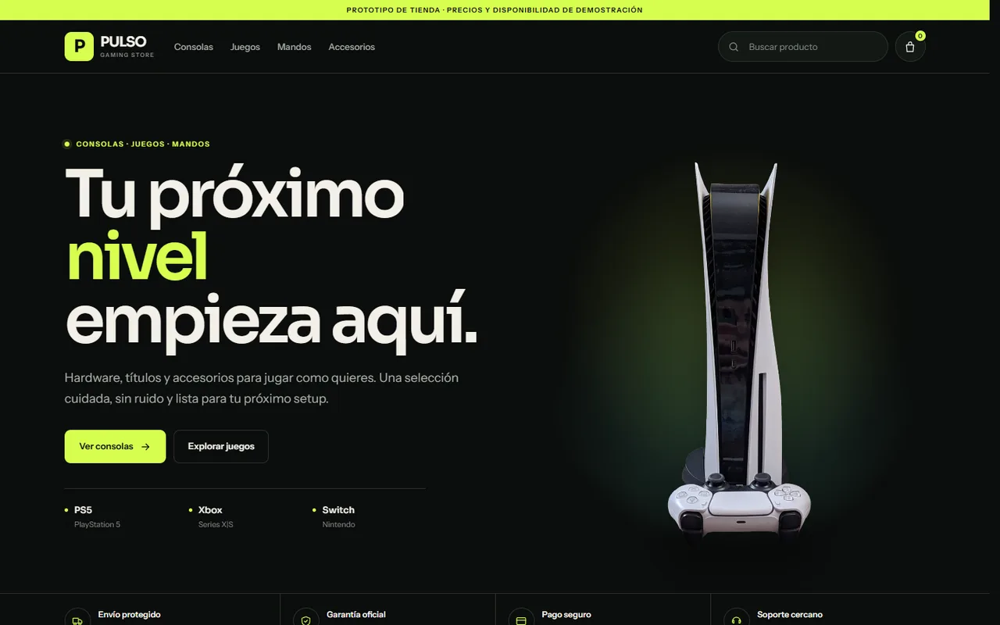
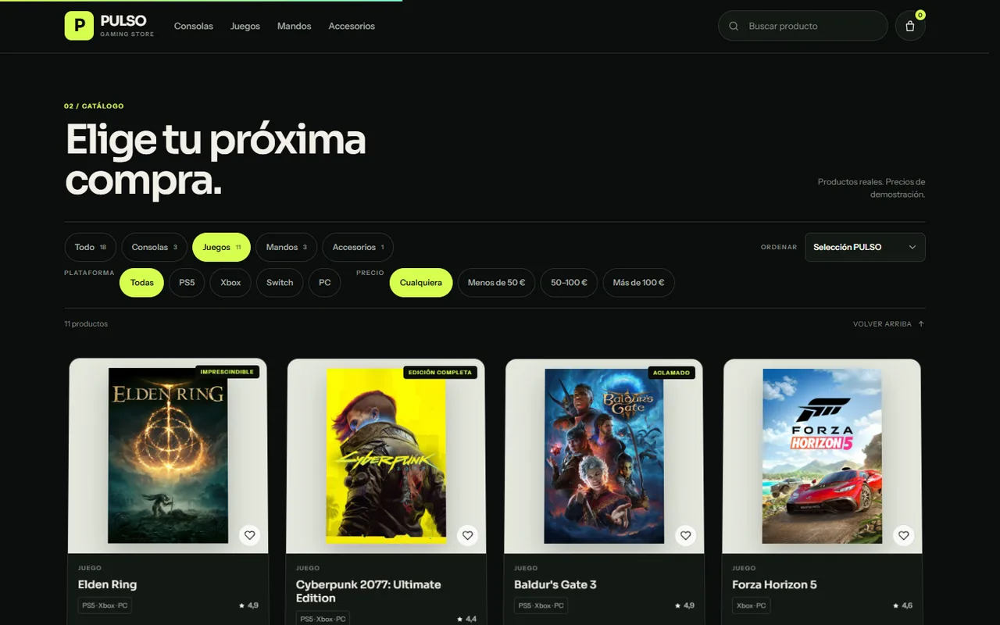
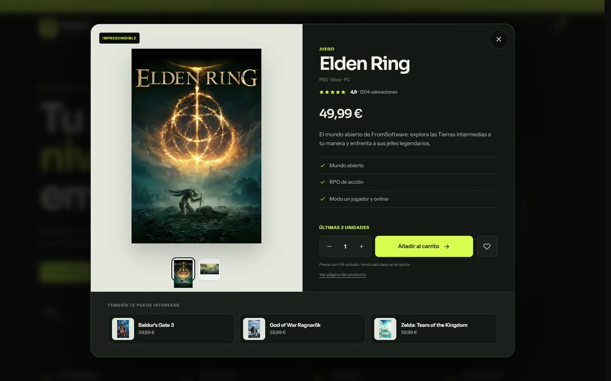

# PULSO — tienda gaming (demo)

[](https://github.com/Baelzn/pulso/actions/workflows/ci.yml)
[](LICENSE)

Prototipo de escaparate para consolas, juegos y accesorios. Todo es estático: no hay
backend, los precios son de demostración y el checkout simula el pedido.

**Demo:** <https://baelzn.github.io/pulso/>

## Capturas



| Catálogo | Ficha de producto |
| --- | --- |
|  |  |

## Cómo verlo

Con un servidor local (recomendado):

```bash
npm install        # solo para los scripts y los tests (sharp, Playwright)
npm run serve      # http://127.0.0.1:8080
```

También vale cualquier servidor estático (`npx serve .`, `python -m http.server 8000`).

Abrir `index.html` con doble clic funciona a medias: en `file://` el service worker no se
registra, así que se pierde el modo sin conexión.

## URLs

El catálogo y la ficha viven en la URL, así que se pueden compartir y recargar:

| URL | Qué hace |
| --- | --- |
| `?categoria=juegos` | Filtra por categoría (`consolas`, `juegos`, `mandos`, `accesorios`) |
| `?categoria=favoritos` | Muestra solo los productos guardados con el corazón |
| `?plataforma=switch` | Filtra por plataforma (`ps5`, `xbox`, `switch`, `pc`) |
| `?precio=50-100` | Filtra por precio (`menos50`, `50-100`, `mas100`) |
| `?q=elden` | Aplica la búsqueda |
| `?orden=rating` | Ordena (`featured`, `rating`, `price-asc`, `price-desc`, `name`) |
| `?producto=ps5` | Abre la ficha del producto |
| `?carrito=1` | Abre el carrito (lo usan las páginas de producto) |
| `?categoria=juegos&plataforma=ps5&precio=menos50&orden=name` | Todo combinado |

Cada producto tiene además su propia página: `p/ps5.html`, `p/elden-ring.html`…

Los filtros y la búsqueda se sincronizan con `history.replaceState` / `pushState`, y
atrás/adelante reconstruyen el estado. Abrir una ficha añade una entrada al historial:
el botón atrás la cierra.

## Stock

Cada producto de `PRODUCTS` lleva un `stock` numérico. No hay otro sitio donde tocarlo:

- `0` → **Agotado**: la tarjeta y la ficha lo avisan y el botón queda deshabilitado.
  Tampoco se puede añadir desde la página estática.
- `1`, `2` o `3` (hasta `LOW_STOCK`) → **Última unidad** / **Últimas N unidades**.
- Más de 3 → sin aviso, se considera stock normal.

El carrito no deja superar el stock: al llegar al máximo se deshabilita el «+» y, en la
ficha, el selector de cantidad se detiene en ese número.

Ahora mismo están agotados `xbox-series-x` y `switch-pro`; con últimas unidades,
`spider-man-2` (1), `elden-ring` y `zelda-totk` (2) y `xbox-controller` (3).

## PWA

`manifest.webmanifest` + `sw.js` permiten instalar la tienda y abrirla sin conexión:

- La primera visita cachea el shell (HTML, CSS, JS, iconos y la imagen social).
- Las navegaciones y el código van a red primero; si no hay conexión, se sirve la copia
  guardada y, en último caso, la portada (las rutas `?categoria=…` siguen funcionando).
- Imágenes y fuentes van a caché primero.
- Los iconos (`assets/icons/`) se generan con `node tools/build-icons.mjs`.

Al cambiar el sitio, sube `VERSION` en `sw.js` para invalidar las cachés antiguas. En
los tests el service worker está bloqueado (`serviceWorkers: "block"`) para que no
sirva copias viejas.

## Tests

```bash
npm test        # 26 tests, headless
npm run test:ui # modo interactivo
```

Playwright arranca `tools/serve.mjs` en el puerto 8123 y usa el **Edge instalado**
(`channel: "msedge"`) para no descargar navegadores. Si prefieres Chromium:

```bash
npx playwright install chromium
# y borra `channel: "msedge"` en playwright.config.mjs
```

Qué cubren:

| Archivo | Qué comprueba |
| --- | --- |
| `tests/catalog.spec.mjs` | 18 productos, filtros de categoría/plataforma/precio, búsqueda, orden, URL, estado vacío, móvil sin desbordes |
| `tests/stock.spec.mjs` | Agotados bloqueados, últimas unidades, límite de cantidad en carrito y modal |
| `tests/cart.spec.mjs` | Añadir/quitar, cantidades, persistencia, `?carrito=1` y checkout demo |
| `tests/product.spec.mjs` | Páginas `p/<id>.html`, canonical, carrito compartido, `?producto=`, favoritos |
| `tests/pwa.spec.mjs` | Manifest, iconos, service worker, tarjetas de compartir y todas las URLs del sitemap |

## Estructura

```
index.html             Marcado de la página (hero, categorías, catálogo, carrito, checkout)
styles.css             Tokens de diseño y layout base
motion.css             Capas de movimiento: reveals, tilt, parallax, flip 3D, marquee
app.js                 Datos de producto, filtros, búsqueda, carrito, checkout y rutas
motion.js              Motor de movimiento: reveals, scroll 3D, tilt y cursor
product-page.js        Carrito y galería de las páginas de producto
manifest.webmanifest   Manifest de la PWA
sw.js                  Service worker (shell offline)
p/                     Una página estática por producto (generadas)
tests/                 Tests de Playwright
tools/                 Scripts de generación y servidor local
assets/icons/          Iconos de la PWA (generados)
assets/img/            Imágenes WebP (originales en `_source/`)
assets/img/compartir/  Tarjetas 1200×630 para compartir cada producto
sitemap.xml            Mapa del sitio
robots.txt             Reglas para rastreadores
```

## Scripts

```bash
npm run serve       # servidor estático en http://127.0.0.1:8080
npm run build       # JSON-LD del catálogo + p/<id>.html + sitemap
npm run build:cards # tarjetas 1200×630 de todos los productos
npm test            # tests de Playwright
```

Y por separado:

```bash
node tools/build-pages.mjs            # p/<id>.html y sitemap.xml
node tools/build-jsonld.mjs           # JSON-LD del catálogo en index.html
node tools/build-jsonld.mjs --dry     # lo imprime sin escribir
node tools/build-cards.mjs            # todas las tarjetas
node tools/build-cards.mjs hades-2    # solo una
node tools/build-icons.mjs            # iconos de la PWA
node tools/fetch-art.mjs              # portadas y capturas de los juegos
node tools/fetch-art.mjs hades-2      # solo la de un juego
```

`fetch-art.mjs` descarga las portadas (`library_600x900`), elige una captura de cada
juego en Steam y recorta el arte oficial de Zelda en Nintendo; después hay que ejecutar
`npm run build && npm run build:cards`.

Todos leen `PRODUCTS` de `app.js`; el dominio está en `tools/products.mjs` (`SITE`).

## Páginas de producto

`p/<id>.html` es una página completa por producto (18 en total) pensada para compartir
y para buscadores: título, descripción, canonical, `og:image`, `product:availability` y
JSON-LD (`Product` + `BreadcrumbList`) propios, con la misma ficha visual (galería,
precio, stock, características, relacionados).

- Se generan desde `PRODUCTS`, no se editan a mano.
- El botón «Añadir al carrito» escribe en el mismo `localStorage` que la tienda y el
  icono del carrito lleva a `index.html?carrito=1`, que abre el carrito ya con el
  producto dentro. Si el producto está agotado, el botón aparece deshabilitado.
- «Abrir en la tienda» va a `index.html?producto=<id>`, donde la ficha se abre en modal.
- La ficha en modal enlaza a su página con «Ver página del producto», y su canonical
  apunta a `p/<id>.html` para no duplicar contenido.
- La tarjeta al compartir es `assets/img/compartir/<id>.jpg` (1200×630). Si falta,
  se usa `assets/img/og-pulso.jpg`.

Cada producto usa `assets/img/<id>.webp` como imagen principal y
`assets/img/<id>-detalle.webp` como segunda vista de la galería: en los juegos es una
captura del juego (1280×720) y en consolas, mandos y accesorios, un primer plano
(700×700). Si añades un producto nuevo, deja los dos archivos con ese nombre (o cambia
`productViews()` en `app.js`) y ejecuta `npm run build && npm run build:cards`.

## Movimiento

Casi todo el movimiento va ligado al scroll y al puntero (sin librerías externas):

- **Hero**: la PS5 es un recorte PNG con transparencia que flota despacio (sube y baja
  unos píxeles) sobre un halo de luz, sin panel ni ficha de precio. El titular entra
  palabra a palabra desde una máscara 3D y, al hacer scroll, el bloque se inclina hacia
  dentro.
- **Títulos de sección**: `motion.js` los parte en palabras y cada una sube desde su
  propia máscara (`data-reveal-title`).
- **Tarjetas de producto**: entran con un giro en 3D y, mientras se desplazan, cada
  tarjeta se inclina y se escala un poco según su posición en la pantalla.
- **Categorías**: la foto se despliega desde abajo con `clip-path` y la tarjeta se
  voltea en 3D al pasar el ratón.
- **Sección «Siéntelo»**: el DualSense, recortado sobre el fondo con su halo, gira en
  3D según cruza la pantalla.
- Además: tilt en las tarjetas con brillo, botones magnéticos, halo de cursor, marquee,
  barra de progreso de lectura y cabecera condensada.

Se respeta `prefers-reduced-motion`: si el sistema pide movimiento reducido, las
animaciones CSS quedan apagadas. El interruptor del pie permite activarlas igualmente
y la preferencia se guarda en `localStorage` (`pulso-motion`).

## Para compartir y buscadores

- **Open Graph y Twitter Card** en el `<head>` de la portada: título, descripción e
  imagen 1200×630 (`assets/img/og-pulso.jpg`). También se actualizan al abrir una ficha,
  para las previsualizaciones que ejecutan JavaScript.
- **Una página por producto** (`p/<id>.html`) con sus propias etiquetas sociales, su
  tarjeta 1200×630 y `canonical` a sí misma: cada enlace se comparte con su producto.
- **JSON-LD** con `Store`, `WebSite` y un `ItemList` de los 18 productos en la portada,
  más un `Product` + `BreadcrumbList` en cada página. La disponibilidad
  (`InStock`, `LimitedAvailability`, `OutOfStock`) sale del stock.
- **`sitemap.xml`** (portada + 18 productos) y **`robots.txt`**.

> **Dominio**: la demo se publica en GitHub Pages (`https://baelzn.github.io/pulso/`).
> Si usas otro dominio, cámbialo en `tools/products.mjs` (`SITE`), en el `<head>` de
> `index.html` (canonical, `og:url`, `og:image`, `twitter:image`) y en `robots.txt`;
> después ejecuta `npm run build` para reescribir las páginas y el sitemap.

## Datos

- Los 18 productos están en la constante `PRODUCTS` de `app.js`, con su `stock`.
- La plataforma del filtro se deduce del texto visible `platform` («PS5 · Xbox · PC»),
  así que no hay que duplicar datos.
- El carrito se guarda en `localStorage` bajo `pulso-cart-v1`.
- Los favoritos se guardan en `localStorage` bajo `pulso-favs-v1`.
- Envío gratis a partir de 49 €; por debajo, 4,95 €.
- Las valoraciones (`rating` y `reviews`) son de demostración, igual que los precios.
- La segunda vista de la galería es una captura real del juego (no un recorte de la
  portada); para cambiarla basta con reemplazar `<id>-detalle.webp`.

## Créditos

Las imágenes son de terceros y se usan con fines demostrativos. La atribución completa
está en el pie de la página. Las portadas y las capturas de los juegos son material
oficial de sus editores (Steam y Nintendo), descargado y redimensionado para la demo.

## Publicación

- **CI**: [`.github/workflows/ci.yml`](.github/workflows/ci.yml) instala dependencias,
  Chromium y pasa los 26 tests en cada push o pull request.
- **Demo**: [`.github/workflows/pages.yml`](.github/workflows/pages.yml) publica el sitio
  estático en GitHub Pages. Hay que activarlo una vez en *Settings → Pages → Source:
  GitHub Actions*.
- El workflow copia solo los archivos del sitio (`index.html`, CSS, JS, `p/`, `assets`…),
  así que `tools/`, `tests/` y `node_modules` no se publican.

## Licencia

El código está bajo licencia [MIT](LICENSE). Las imágenes de producto, portadas y
capturas pertenecen a sus respectivos titulares y quedan fuera de esa licencia; se usan
aquí con fines demostrativos (ver Créditos).
